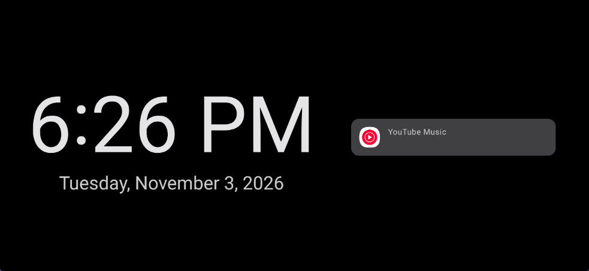
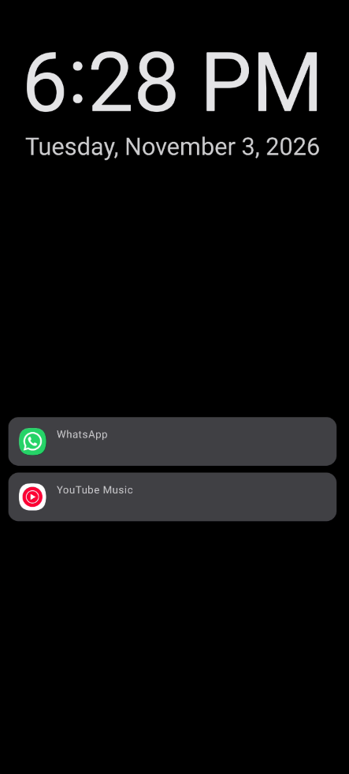
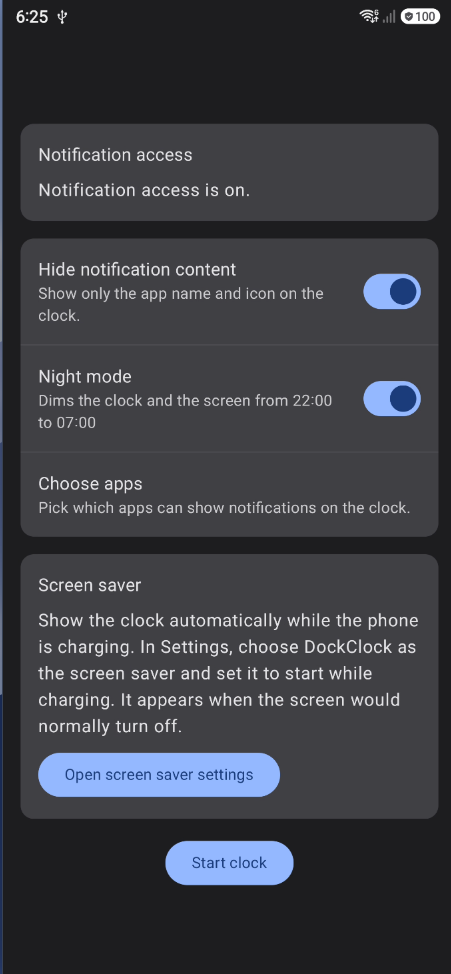

# DockClock

[](https://github.com/Dustin2/dock-clock/actions/workflows/ci.yml)

DockClock turns an Android phone into a desk clock. It shows a large, always-on clock on a black background, together with your recent notifications. It works like a smart display on your nightstand, but uses a phone you already have.



| Portrait (screen saver) | Settings |
|---|---|
|  |  |

## Features

- **Full-screen clock.** The text resizes automatically to fit the screen. It follows the device's time zone and 12- or 24-hour format, and keeps the screen on.
- **Notifications.** Active notifications appear next to the clock, with the app icon, title, and text. Notifications are read on the device only. They never leave the phone and are never logged.
- **Notification privacy:**
  - Choose which apps' notifications are shown on the clock.
  - Hide notification content, so that only the app name is visible.
- **Screen saver.** The clock appears automatically while the phone is charging. It adapts to portrait and landscape.
- **Night mode.** From 22:00 to 07:00, the clock lowers the brightness and dims its content.
- **Burn-in protection.** The content shifts a few pixels every minute to protect OLED screens.

## Tech stack

- Kotlin, Jetpack Compose, and Material 3
- Coroutines and Flow, with ViewModel and StateFlow
- Hilt for dependency injection
- DataStore for preferences
- Navigation 3
- JUnit and Turbine for tests; ktlint and detekt for linting
- GitHub Actions for CI

## Architecture

The code follows the [Android architecture guide](https://developer.android.com/topic/architecture) and is organized by feature:

```text
app/src/main/java/io/github/dustin2/dockclock/
├── core/          # Theme and app-wide DI (DataStore)
└── feature/
    ├── clock/          # Clock screen, ViewModel, night mode, burn-in shift
    ├── notifications/  # NotificationListenerService and in-memory repository
    ├── permissions/    # Notification access status and explanation
    ├── settings/       # User preferences backed by DataStore
    ├── appselection/   # Picking which apps appear on the clock
    └── screensaver/    # DreamService that hosts the clock
```

- **Unidirectional data flow.** Each screen has a ViewModel that exposes a single `StateFlow` of UI state. The UI sends events back to the ViewModel.
- **Repositories as the single source of truth** for notifications and settings.
- **Android APIs behind interfaces** (time settings, package manager, notification access). This lets the logic be unit tested on the JVM with fakes.
- **One clock screen for two hosts.** The same clock screen runs in both `ClockActivity` and the screen saver. Because `DreamService` is not an Activity, the screen saver provides its own lifecycle, ViewModel store, and saved-state owners for Compose.

## Permissions

| Permission | Why |
|---|---|
| Notification access | Needed to show notifications on the clock. It is optional: without it, the clock still works. |

The app has no internet permission, no analytics, and no accounts.

## Building

Requirements: JDK 21 and the Android SDK (compile SDK 37). The app supports Android 8.0 (API 26) and newer.

```bash
./gradlew assembleDebug
```

The APK is generated in `app/build/outputs/apk/debug/`. CI runs the same checks on every pull request:

```bash
./gradlew ktlintCheck detekt testDebugUnitTest assembleDebug
```

## License

DockClock is a learning and portfolio project, released under the [MIT License](LICENSE).
